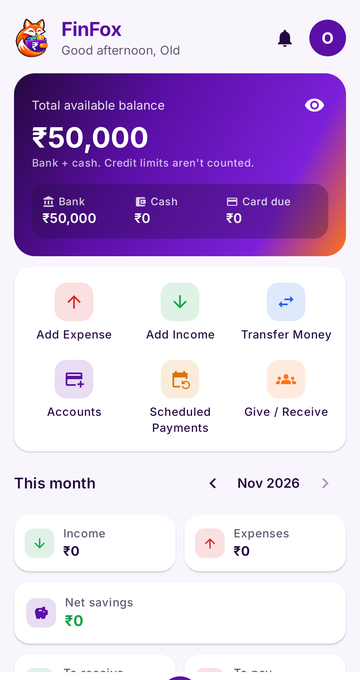
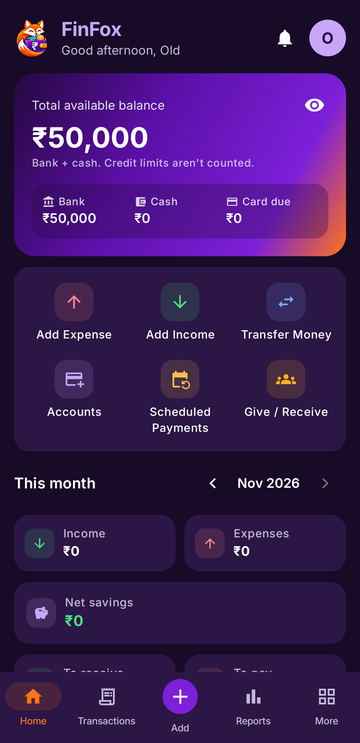
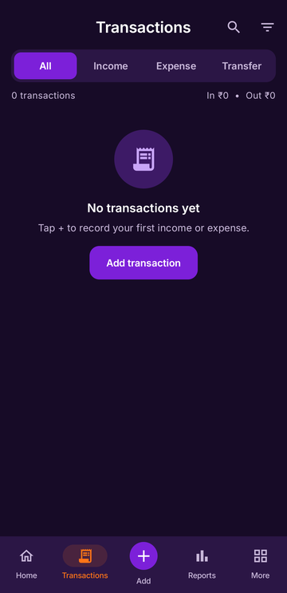
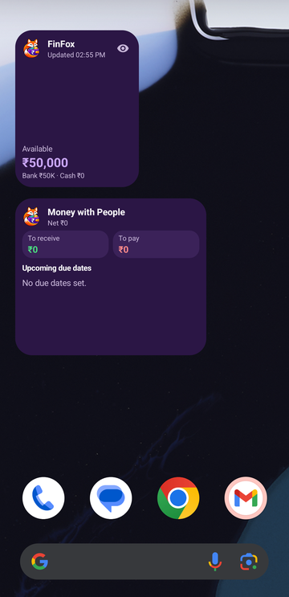
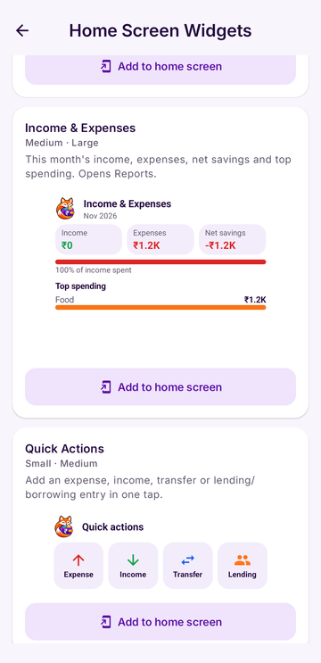
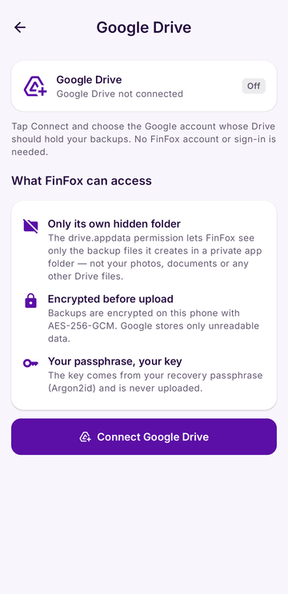

<div align="center">


# FinFox

**A private, offline-first personal finance tracker for Android.**

Track bank accounts, credit cards, cash, EMIs, SIPs, bills, money lent and borrowed, budgets and savings goals,
with no account, no ads and no server. Your money data never leaves your phone unless you back it up,
encrypted, to your own Google Drive.

[](#-install)
[](https://kotlinlang.org)
[](https://developer.android.com/compose)
[](LICENSE)
[](#-testing)

[Features](#-features) · [Install](#-install) · [Build](#-build-from-source) · [Architecture](#-architecture) · [Contributing](#-contributing)

</div>

---

## 📱 Screenshots

<table>
  <tr>
    <td align="center"><br/><sub>Dashboard</sub></td>
    <td align="center"><br/><sub>Dark mode</sub></td>
    <td align="center"><br/><sub>Transactions</sub></td>
  </tr>
  <tr>
    <td align="center"><br/><sub>Home screen widgets</sub></td>
    <td align="center"><br/><sub>Widget gallery</sub></td>
    <td align="center"><br/><sub>Encrypted Drive backup</sub></td>
  </tr>
</table>

## ✨ Features

### Money tracking

- 🏦 **Accounts:** bank accounts, credit cards (limit, statement and due day) and cash wallets
- 💸 **Transactions:** income, expenses and transfers with categories, tags, search, filters and sorting
- 📅 **Scheduled payments:** EMI, SIP, rent, bills and subscriptions. Mark as paid, skip, pause, history and calendar view
- 🤝 **Money with people:** lend and borrow, partial repayments, settle or write off, due dates
- 🎯 **Budgets** per category with 80 / 90 / 100 % alerts, and **savings goals** with milestones
- 📊 **Reports:** income vs expenses, cash flow, category breakdowns, CSV and PDF export

### Automatic entries

- 📷 **Scan & Pay:** scan any UPI QR (or type a UPI ID), pick a category, and pay with Google Pay, PhonePe, Paytm, BHIM or your bank's app. FinFox records the expense as soon as the UPI app confirms. If the app doesn't report back, FinFox matches the bank SMS that follows
- ⚡ **Auto-capture:** debit and credit alerts from bank SMS, bank alert emails (Gmail, Outlook) and payment notifications from UPI and bank apps become transactions automatically, including credit card spends
  - The last 4 digits in the message pick the right account; merchants pick the category, and FinFox learns from every correction
  - The same payment reported by SMS, email *and* the UPI app is recorded once (emails are matched for up to 3 hours, since they often arrive late). Personal emails are never read. Money moved between your own accounts, or a card bill paid from your bank, becomes one transfer
  - OTPs, payment requests, reminders, offers and failed payments are ignored
  - Prefer to check first? Turn off "Add without asking" and confirm entries from a review list. You can also import the last 30 days of bank SMS

### Made for your phone

- 🧩 **Seven home screen widgets** (Jetpack Glance): balance, income and expenses, quick actions, upcoming payments, money with people, budget, credit cards. They are responsive, follow light and dark mode, and have a privacy mode
- 🔔 **Smart reminders:** "Mark as paid" (asks for your PIN first), "Remind later", quiet hours, amounts hidden on the lock screen, and an in-app notification center
- 🌗 **Light, dark and follow-system themes** in the FinFox purple and orange design, using the Inter typeface
- ♿ **Accessible:** WCAG AA text contrast (checked by tests), font scaling, reduced-motion support and 48 dp touch targets

### Private by design

- 🔐 **PIN and fingerprint lock** with auto-lock, lockout after wrong attempts and an offline recovery code
- ☁️ **Optional Google Drive backup**, encrypted on the device with AES-256-GCM and an Argon2id key derived from your passphrase. It uses only Drive's hidden app folder
- 🚫 **No sign-in, no analytics, no ads, no backend.** Network is used only for the optional Drive backup
- 📩 **Auto-capture reads messages on the phone only.** SMS and notification access are optional and asked for only when you turn the feature on. Message text is parsed locally, kept in a local log you can clear, and never uploaded or backed up

> FinFox is a **tracker**. It never moves money itself and never asks for bank passwords, card numbers, CVVs or UPI PINs. Scan & Pay only hands the payment to your UPI app, where you enter your PIN.

## 📥 Install

1. Download `FinFox-<version>-release.apk` from the [Releases](https://github.com/niraj-ghetiya/FinFox/releases) page, or receive it as a file on WhatsApp, Telegram or email.
2. Open the file on your phone. If Android asks, allow **Install unknown apps** for that app (Chrome, Files, WhatsApp…).
3. Tap **Install**. Play Protect may warn because the app isn't from the Play Store; choose **More details → Install anyway**.

Updates install over the previous version and keep all your data, as long as they're signed with the same release key.

> **Auto-capture on Android 13+:** Android blocks SMS and notification access for apps installed from an APK file. If you see **"Restricted setting"**, open **App info → ⋮ (top right) → Allow restricted settings**, then grant the permission again from FinFox → Settings → Auto-capture payments.

## 🛠 Build from source

**Requirements:** JDK 17, Android SDK (platform 35, build-tools 35). Android Studio Ladybug or newer works out of the box.

```bash
git clone https://github.com/niraj-ghetiya/FinFox.git
cd FinFox
echo "sdk.dir=/path/to/Android/sdk" > local.properties   # Android Studio creates this for you

./gradlew assembleDebug               # debug APK  → app/build/outputs/apk/debug/
./gradlew testDebugUnitTest           # 187 JVM + Robolectric tests
./gradlew connectedDebugAndroidTest   # instrumented tests (device or emulator)
./gradlew assembleRelease             # minified release APK
```

> **Debug vs release size:** the debug APK is about 28 MB because nothing is shrunk. The release build runs R8 code and resource shrinking and comes out at about 7 MB. Always share the release APK.

### Release signing

Create a keystore once and **back it up**. If you lose it, you can never ship an update to existing installs.

```bash
keytool -genkeypair -v -keystore finfox-release.jks -storetype PKCS12 \
        -alias finfox -keyalg RSA -keysize 4096 -validity 10000
```

Then add `keystore.properties` to the project root. Both files are git-ignored:

```properties
storeFile=finfox-release.jks
storePassword=…
keyAlias=finfox
keyPassword=…
```

`./gradlew assembleRelease` now produces a signed APK. Without the file, the release APK is built unsigned.

### Google Drive backup (optional)

Drive backup needs no sign-in, no Firebase and no secrets in the APK. You only register your app with Google:

1. In [Google Cloud Console](https://console.cloud.google.com), create or select a project and enable the **Google Drive API**.
2. Under **OAuth consent screen**, add the scope `https://www.googleapis.com/auth/drive.appdata`. While the app is in *Testing* mode, add your Google account as a test user.
3. Under **Credentials → Create OAuth client ID → Android**, create one client per signing key:

   | Build | Package name | SHA-1 from |
   |---|---|---|
   | Debug | `com.mymoney.app.debug` | `keytool -list -v -keystore ~/.android/debug.keystore -alias androiddebugkey -storepass android` |
   | Release | `com.mymoney.app` | `keytool -list -v -keystore finfox-release.jks -alias finfox` |

Google matches the client by package name and SHA-1 at runtime, so nothing is copied into the project. In the app, **Settings → Connect Google Drive** opens Google's account picker. FinFox requests only `drive.appdata` (its hidden app folder) and `email` (to remember which account holds the backups).

> The application id is still `com.mymoney.app`, from the project's original name, so existing installs keep upgrading in place.

## 🏗 Architecture

MVVM with clean layering: **Compose UI → ViewModel → Repository → Room DAO**, wired with Hilt.

```
app/src/main/java/com/mymoney/app/
├── core/            Money (paise math, INR formatting), dates, periods
├── data/db/         Room entities, DAOs, migrations (v1 → v2), seed data
├── data/repo/       Repositories: business rules + multi-table Room transactions
├── domain/          Pure logic: transaction rules, schedule math, reports
├── backup/          Encrypted backup format, key store, replace / merge restore, CSV & PDF export
├── cloud/           Drive authorization, Drive REST client, backup service + WorkManager worker
├── notifications/   Dispatcher (preferences, quiet hours, privacy, history), reminder engine
├── widgets/         7 Glance widgets, snapshot repository, change-driven refresh
├── security/        PIN hashing, Android Keystore secret box, app lock
└── ui/              Compose screens + ViewModels, FinFox theme, components, navigation
```

| Area | Choice |
|---|---|
| UI | Kotlin 2.0, Jetpack Compose, Material 3, Inter (bundled) |
| Data | Room (SQLite) with exported schemas and explicit migrations; DataStore for preferences |
| DI / background | Hilt, WorkManager (reminders, backups). No AlarmManager, no foreground services |
| Widgets | Jetpack Glance 1.1 |
| Cloud | Google Drive REST v3 (`appDataFolder`) via Retrofit + OkHttp; Play Services `AuthorizationClient` |
| Crypto | AES-256-GCM, Argon2id (BouncyCastle), PBKDF2 for the PIN, Android Keystore |
| Min / target SDK | 26 (Android 8.0) / 35 |

### How balances stay correct

- **Money is stored as `Long` paise.** No floating point anywhere.
- **Balances are derived, never stored:** `opening + Σ ledger effects`. Editing or deleting a transaction can't make a balance drift, and every multi-table change is a single Room transaction.
- **Available balance = bank + cash.** Credit limits are never counted as money; card outstanding is shown separately.
- Card bill payments are transfers, not expenses. Lending and borrowing are never counted as income or expense. Savings goals earmark money instead of moving it.
- Scheduled payments never deduct money automatically. A unique `(schedule, due date)` index makes paying the same installment twice impossible.

### Backup format

```
"MMBK" | version 2 | Argon2id | memory, iterations, parallelism | salt | IV | AES-256-GCM(JSON)
```

The whole header is authenticated, so its parameters can't be tampered with. The passphrase and key are never uploaded, so losing the passphrase means the backup can't be decrypted. Restore validates the schema and referential integrity, shows a preview, lets you **Merge** (adds only missing records, idempotent) or **Replace** everything, runs in one transaction with a foreign-key check, and keeps a safety copy so you can undo it. Backups contain financial records and preferences, never the PIN, biometric data, tokens or keys.

## 🎨 Design system

All colours live in [`ui/theme/Color.kt`](app/src/main/java/com/mymoney/app/ui/theme/Color.kt) and are applied through [`FinFoxTheme.kt`](app/src/main/java/com/mymoney/app/ui/theme/FinFoxTheme.kt). UI code uses no raw hex values.

| | Light | Dark |
|---|---|---|
| Background / card | `#F8F6FC` / `#FFFFFF` | `#170B27` / `#2B1645` |
| Primary button | `#5B0FA6` | `#7C20D9` |
| Selected navigation | `#7C20D9` | `#FF7417` |
| Accent | `#FF7417` | `#FFB21C` |

Status colours: income `#16A34A` · expense `#DC2626` · transfer `#2563EB` · EMI/upcoming `#D97706` · savings `#0D9488` · overdue `#B91C1C`. They always appear with an icon or label, never as the only cue. Brand gradient: `#25083F → #5B0FA6 → #7C20D9 → #FF7417`.

## 🧪 Testing

`./gradlew testDebugUnitTest` runs **127 tests** on the JVM (Robolectric for Room, DataStore, Compose and Glance):

| Area | What's covered |
|---|---|
| Finance | Balances, cards, transfers, loans and repayments, schedules (no double payment), budgets, goals, filters |
| Persistence | Data survives restart; migration from a real v1 database to v2 with schema validation |
| Backup | Cross-device restore with the passphrase only, wrong passphrase, corrupted, tampered and truncated files, malicious KDF parameters, merge de-duplication, undo |
| Cloud | Drive REST client against a mock server, token expiry and retry, verification failures, WorkManager retry behaviour |
| Notifications | Actions, lock-screen privacy, quiet hours, snooze, duplicate prevention, permission denied |
| Widgets | Rendering at small, medium and large sizes, privacy mode, refresh after transactions, RemoteViews child limits |
| Theme | Brand colours match the spec, WCAG contrast in both themes, theme persistence |

Instrumented tests (`app/src/androidTest`) cover the real Android Keystore, `MigrationTestHelper` and on-device persistence.

### Adding a database migration

1. Change the entities and bump `AppDatabase.VERSION`.
2. Build once. Room exports `app/schemas/.../<n>.json`.
3. Add a `Migration(n-1, n)` to `Migrations.ALL` and a test in `MigrationTest` / `DeviceTests`.

Destructive fallback is intentionally disabled, so user data is never dropped silently.

## 🤝 Contributing

Contributions are welcome!

1. Fork the repo and create a branch: `git checkout -b feature/my-change`.
2. Keep money as `Long` paise and put business rules in repositories, not in UI code.
3. Use theme tokens (`MaterialTheme.colorScheme`, `FinFoxTheme.colors`) instead of hard-coded colours.
4. Add or update tests and make sure `./gradlew testDebugUnitTest` passes.
5. Open a pull request describing what changed and why.

Found a bug or have an idea? [Open an issue](https://github.com/niraj-ghetiya/FinFox/issues).

**Security:** please don't post vulnerabilities in public issues. Use GitHub's private vulnerability reporting under the repository's **Security** tab.

## 📄 License

FinFox is released under the [MIT License](LICENSE).

The bundled [Inter](https://rsms.me/inter/) typeface is licensed under the SIL Open Font License 1.1 (see [`licenses/Inter-OFL.txt`](licenses/Inter-OFL.txt)).

<div align="center">
<sub>Made with 🧡 and Kotlin.</sub>
</div>
